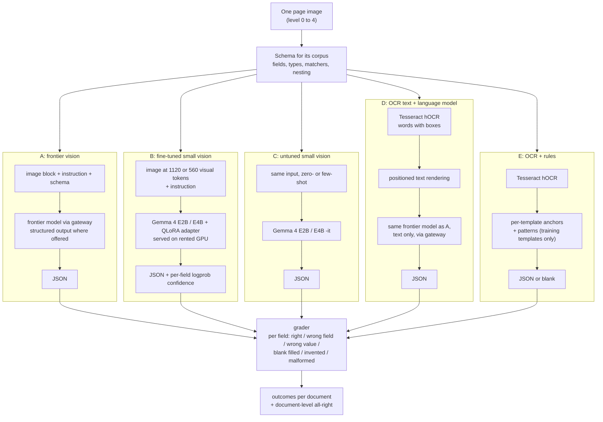
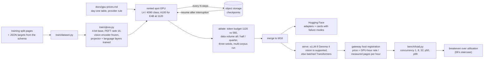
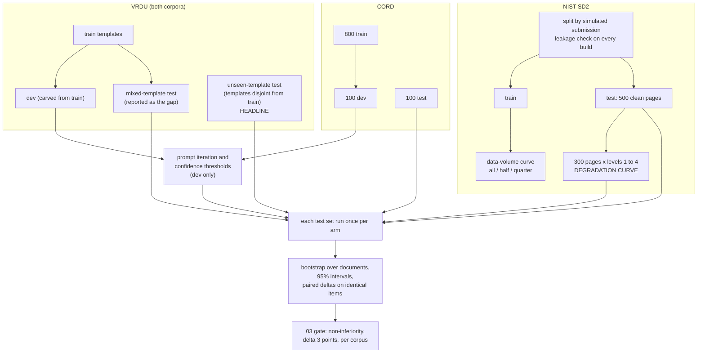
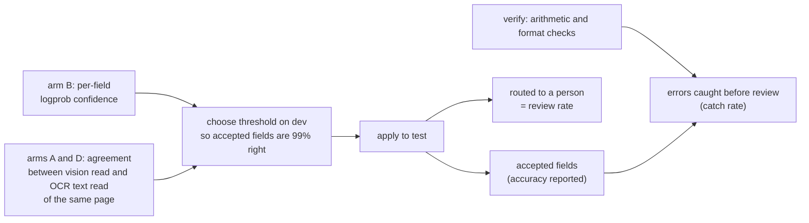
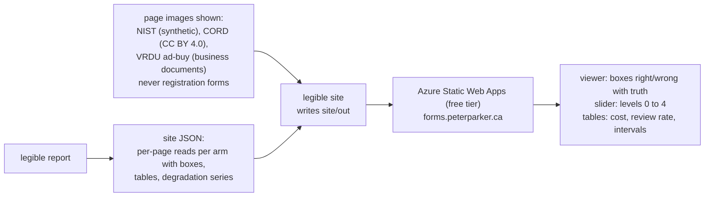

# Architecture

The diagrams behind [PLAN.md](../PLAN.md), in Mermaid so they render on GitHub and change in
the same commit as the code they describe. Six views: the system, one page through the five
arms, the fine-tuning and serving loop, the evaluation design, the review-rate computation, and
the public site.

## 1. The system

Public corpora in, numbers out, and one ledger for every model call.

```mermaid
flowchart LR
  subgraph corpora["Public corpora (fetched, checksummed, never committed)"]
    VRDU["VRDU<br/>registration and ad-buy forms<br/>PDF + annotations"]
    CORD["CORD v2<br/>receipts<br/>photos + annotations"]
    NIST["NIST SD2<br/>tax forms<br/>binary scans + field files"]
  end

  corpora --> fetch["legible data fetch<br/>loaders, checksums, licences quoted"]
  fetch --> render["render<br/>300 dpi pages + manifest"]
  render --> split["split<br/>benchmark splits, NIST by submission,<br/>dev carve-out, leakage check"]
  split --> degrade["degrade<br/>levels 0 to 4, fixed seed,<br/>calibrated to OCR word accuracy"]
  degrade --> pages[("data/pages<br/>data/degraded")]

  pages --> arms
  subgraph arms["Five arms, same pages"]
    A["A frontier vision"]
    B["B fine-tuned small vision"]
    C["C untuned small vision"]
    D["D OCR text + language model"]
    E["E OCR + rules"]
  end

  A & D -->|"image or text blocks,<br/>data_class=public"| GW["04 boundary gateway<br/>ledger, caps, batch, cache"]
  GW --> vendors["Anthropic / OpenAI / Google"]
  B & C -->|"served on rented GPU,<br/>registered as a host"| GW
  D & E --> OCR["Tesseract (hOCR)"]

  arms --> grade["grade<br/>schema matchers, miss taxonomy,<br/>bootstrap over documents, paired deltas"]
  grade --> results[("data/runs<br/>predictions + outcomes")]
  results --> review["review<br/>confidence thresholds on dev,<br/>review rate on test"]
  results --> verify["verify<br/>arithmetic and format checks"]
  results --> gate["03 gate<br/>non-inferiority per corpus"]
  GW -->|"cost per page"| cost["bench/cost + breakeven<br/>(06's arithmetic)"]
  review & verify & gate & cost --> report["report<br/>README tables, charts, cards"]
  report --> site["site<br/>forms.peterparker.ca (static)"]
```

## 2. One page through the five arms

What each arm sees and what it returns. The schema is one definition; the prompt, the training
target and the grader all read from it.

## 3. Fine-tuning and serving

06's loop with a vision encoder. Spot GPUs, so every run resumes from object storage.

## 4. Evaluation design

Which pages carry which claim, and why the test sets are touched once.

## 5. Review rate

The product number: at 99 percent accuracy on the fields a machine keeps, how many fields go
to a person.

## 6. The public site

Static, free, nothing modelled in the browser, nothing uploaded.

